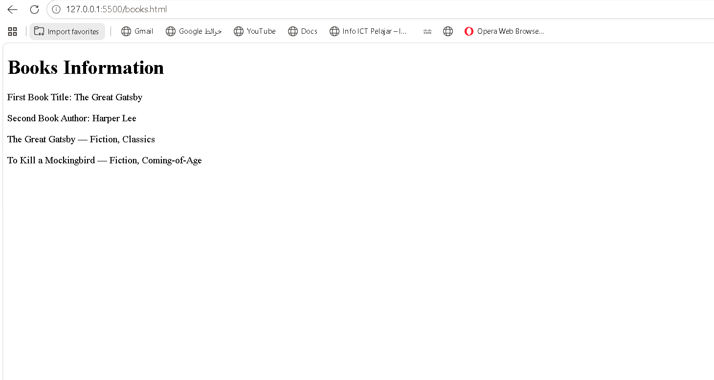
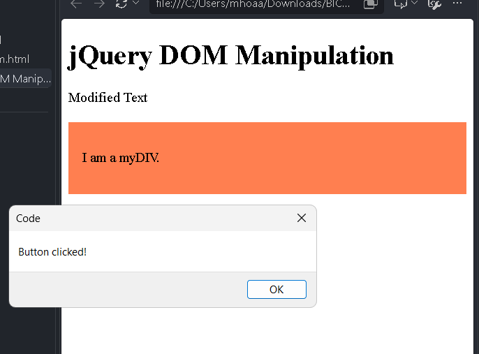

# BIC21203 Lab 4b – Client-Side Scripting (JSON and jQuery)

## Student Information

- **Name:** Mohamed Hassan Ibrahim
- **Student ID:** BI230051
- **Course:** BIC21203 Web Development
- **Academic Session:** 2026/2027

## Introduction

This laboratory explores client-side scripting using JSON, modern JavaScript, and jQuery. It demonstrates how to create JSON data, retrieve and display information using the Fetch API, and manipulate HTML elements using jQuery.

## Question 1 – Create and Structure JSON Data

Created a JSON file named `books.json` containing a top-level books array with two book objects.

Each book contains:
- Title
- Author
- Publication year
- Genres

The JSON data uses the correct data types and valid JSON syntax.

## Question 2 – Retrieve and Display JSON Data

Created `books.html` using the JavaScript Fetch API to retrieve data from `books.json`.

The webpage displays:
- The title of the first book.
- The author of the second book.
- The genres of both books, grouped by title.

The implementation uses async/await, textContent, createElement(), and error handling with try...catch.

## Question 3 – Compare Native JavaScript and jQuery

Created `jquery-dom.html` using jQuery 4.0.0.

Three jQuery operations were implemented:

1. `.text()` – Changes the text to "Modified Text".
2. `.addClass()` – Adds the `myStyle` CSS class.
3. `.on("click", ...)` – Displays an alert when the button is clicked.

## Screenshots of Outputs

### Question 2 – JSON Data Retrieved Using Live Server

### Question 3 – jQuery DOM Manipulation

## How to Run the Project

1. Download or clone this repository.
2. Open the project folder in Visual Studio Code.
3. Install the Live Server extension if necessary.
4. Right-click `books.html` and select Open with Live Server.
5. Open `jquery-dom.html` using Live Server to test the jQuery operations.
6. Ensure you have an internet connection for the jQuery CDN.

## Files Included

- `books.json` – JSON dataset.
- `books.html` – Fetches and displays JSON data.
- `jquery-dom.html` – Demonstrates jQuery DOM manipulation.
- `q2-books-live-server.png` – Question 2 output screenshot.
- `q3-jquery-output.png` – Question 3 output screenshot.

## Conclusion

This laboratory provided practical experience in creating and handling JSON data, retrieving information using the Fetch API, and manipulating webpage elements using jQuery. It also helped develop an understanding of the differences between native JavaScript and jQuery.

